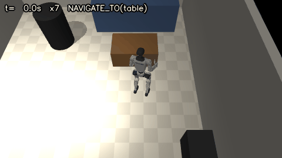

# HomeBot-Sim

Unitree **G1** humanoid with a 5-finger **Inspire RH56** right hand in a MuJoCo apartment (~8 x 6 m). The robot
takes a command such as *"bring the can to the sink"*, walks to the dining table with a real learned walking
policy, finds the object with its head RGB-D camera, grasps it by contact, carries it to the kitchen and drops it
into the sink basin, while a person (and a pet) move around.

Everything the robot does goes through the physics: the legs are driven by Unitree's pretrained walking policy,
the object is held only by finger contacts, and the object pose comes from the camera image, not from the
simulator state.

## Results (scripted expert with camera perception; full numbers in `report/report.md`)

| experiment | result |
|---|---|
| E1 navigation, 100 runs per level | level 1: **99%**, level 2 (person): **94%**, level 3 (person + pet): **80%**; 0 furniture contacts, 0 falls |
| E4 level 2 with the safety layer off | 99% reached, but person contacts while moving 7 -> **26** |
| E2 pick, 50 runs (start +-10 cm / +-15 deg) | **50/50**, object pose error median 1.7 mm, 0 arm contacts |
| E2 drop into the sink (basin found by the camera), 50 runs | **50/50**, basin error median 1.2 mm (max 3.3 mm), 6 arm stops (light contacts) |
| E2 drop, sink moved along the counter by up to +-24 cm (not told to the robot), 50 runs | **50/50**, basin error median 1.2 mm (max 2.7 mm) |
| E3 full task with a person, 30 runs | **29/30 (97%)**, 181 s on average, basin error median 1.7 mm, 0 falls |
| E3 with the sink moved by up to +-24 cm, 30 runs | **28/30 (93%)**, basin error median 1.8 mm, 0 falls |
| Dataset | 60 LeRobot v2.1 episodes (30 pick, 30 drop; generated before the sink perception) |

All E3 failures left are navigation time-outs on the way to the sink (180 s). The held can still creeps slowly in
the hand while the robot walks (gait vibration); holding the arm still relative to the body during the carry
(below) cut the creep about 3x (`scripts/carry_bench.py`) and no E3 run lost the can.

## Demo



*"bring the can to the sink"*, level 2 (a person walks around, the red cylinder), seed 2, shown 7x faster: the robot
walks from the living room to the dining table, raises its hand, grasps the can, carries it to the kitchen, finds
the sink basin with its head camera and drops the can in (198 s). Full-length video with the head-camera view and
the perception output: [report/demo_full_task.mp4](report/demo_full_task.mp4).

```bash
python scripts/view.py                       # MuJoCo window: "bring the can to the sink", level 2, seed 2
python scripts/view.py --level 3 --seed 7    # another episode (with the pet)
```

The episode is simulated first (2-3 min, same code as the evaluations) and then replayed at real time; the
recording is cached in `logs/` (replayed at once next time, re-simulated when the code changed, `--fresh` forces
it). Keys: space pause, +/- speed, R restart, F follow the robot. The replay draws reduced copies of the robot
meshes (25 % of the ~0.6 M triangles, orientation-checked against the originals, cached in `logs/lowpoly/`) and
no shadows: ~25 fps at 1280x720 on an integrated Intel GPU, against ~9 fps with the original meshes.
`--full-detail` draws the original meshes, `--shadows` turns shadows on (best with the discrete GPU selected for
`python.exe` in Windows graphics settings). Physics and perception always use the full models.
Video: `report/demo_full_task.mp4`.

## Architecture

```
command ─► TaskRunner (state machine, homebot/tasks.py)
             │
             ├─ NAVIGATE_TO ── 2D LiDAR (mj_multiRay) ─► occupancy memory + obstacle tracker
             │                  A* 1 Hz ─► DWA 10 Hz ─► safety layer 50 Hz (stop / slow / evade)
             │                  ─► velocity command ─► walking policy (unitree_rl_gym, PI velocity tracking)
             │
             └─ MANIPULATE ─── perception (head RGB-D): support plane RANSAC ─► clustering ─► recognition +
                                6D pose (ICP vs YCB meshes) ─► Kalman tracking
                                ALIGN (step until the object is where the hand works) ─► stand + base lock
                                ─► grasp (handshake power grasp, thumb opposition, squeeze, slow lift)
                                ─► carry ─► drop into the sink
```

| module | what it does |
|---|---|
| `homebot/apartment.py` | apartment layout (living room, kitchen, 1.2 x 0.8 m dining table, counter with an 18 cm deep sink basin), movable chairs displaced each episode (walkways and manipulation workspace kept free), YCB object table, MJCF |
| `homebot/g1.py` | Menagerie G1 (29 DoF) + Inspire hands from `unitree_ros` (mimic joints as equalities, 6 position actuators per hand), leg torque motors, cameras, arm IK (damped least squares, joint margins, null-space posture, rate limit, multi-start, collision check) |
| `homebot/locomotion/walker.py` | Unitree's pretrained G1 walking policy (`motion.pt`, from unitree_rl_gym, BSD-3), pose hold, base lock |
| `homebot/env.py` | `HomeEnv`: 50 Hz control loop, velocity tracking, person / pet models, contacts, runtime arm safety (contacts with furniture / own body counted; > 25 N stops the arm) |
| `homebot/lidar.py`, `homebot/nav/*` | 2D LiDAR, occupancy memory with ray clearing, dynamic obstacle tracker, A*, DWA (EDT distance field), safety layer |
| `homebot/perception.py` | head RGB-D perception: detection, recognition, 6D pose, tracking (details below) |
| `homebot/expert.py` | scripted manipulation expert (pick / drop), also the demo generator |
| `homebot/policy.py` | learned policy wrapper (ACT TorchScript or GR00T N1.7 inference server) with the same `pick_cup()` / `place_cup()` interface |
| `homebot/record.py` | LeRobot v2.1 dataset writer (+ GR00T `modality.json`) |
| `homebot/sonic_bridge.py` | velocity limiter between the planner and the walking controller (carry limits) |

### Perception (`homebot/perception.py`)

Input: the head camera colour + depth image (320 x 240, depth noise ~2 mm x d²) and the camera pose from the
robot's joint state. No simulator segmentation or object state is used.

1. **Detection** - depth back-projected to a world point cloud; robot self-filter (arm / hand geometry at the
   current joint state removed, like `robot_self_filter` in ROS); RANSAC for the horizontal support plane; points
   1-30 cm above it grouped by connected components; a cluster must rest on the support (no surface below it).
2. **Recognition** - each cluster is registered against every model of the YCB library (tomato soup can, mug);
   height gate + ICP residual decide the label (rejected above 4 mm RMSE).
3. **6D pose** - trimmed point-to-point ICP of the cluster onto the YCB mesh points, initialised upright on the
   plane at several yaw angles. (The can is rotationally symmetric: its yaw is not observable from geometry.)
4. **Tracking** - one Kalman filter per object (random-walk position model, objects rest until moved),
   nearest-neighbour gating, track IDs, confirmation after 2 hits, deletion after 10 misses.
5. **Sink basin** - a hole in a horizontal support plane (filled-hole test on a 2 cm grid) that has surface
   points below the plane (a depression, not an occlusion); the rim is fitted as a rectangle along the hole's
   principal axes and each edge is refined on the nearest counter-top points; median over 3 frames. If the basin
   is not fully in view the robot turns in place in ~30 deg steps and looks again. The drop target and the
   stance (square to the counter edge) come only from this estimate.

The expert walks to the table's usual object spot from the semantic map, refines the target from the camera every
0.5 s while stepping, measures the 6D pose again once standing, and grasps at that pose. The pose of the object in
the hand (needed to drop it over the basin) is the camera measurement at closing, carried by the hand kinematics.

### Grasp and drop

Taken from the HomeHand project's cylindrical power wrap and re-tuned on this model (`scripts/grasp_bench.py`):
handshake palm orientation, thumb turned into opposition before the approach, the hand comes down behind the object
and slides forward along the finger direction, the four fingers close first and the thumb last, a short squeeze,
then a slow lift (SIMPLE / BODex style pregrasp -> grasp -> squeeze). The drop places the object 4 cm over the
front half of the basin and opens the hand.

### Safety

Carrying: while the hand holds an object and walks, the arm joints are solved once for the carry pose and then held
still relative to the body (no IK chasing the swaying, bobbing pelvis, which made the arm servos resonate and the
object creep out of the grip); for the last steps to the counter the object is carried 10 cm higher, and the
robot stands square to the counter edge (orientation from the perceived basin).

Walking posture: with an empty hand both arms hang beside the body and swing with the opposite leg (driven by
the measured hip pitch, so the swing follows the real stride and stops when the legs stop). At the table the
robot first raises the hand to the ready pose on a collision-checked joint path, then steps close; after the
drop the arm is lowered again. While carrying, the right hand holds the object in front and the left arm swings.

Arm: joints keep 0.1 rad from their limits, arm speed <= 1.5 rad/s, every joint-space path is collision-checked
before the arm moves (via a configuration 10 cm higher if needed), contacts of the arm / hand with furniture or the
robot's own body are counted and stop the arm above 25 N.

Navigation:
- footprint radius 0.37 m, measured on the walking G1 (the right Inspire hand in the carry pose sets it), plus a
  0.05 m hard clearance in the DWA; the global A* plans only through gaps 4 cm wider than the DWA needs (no
  dead-locks at gaps right at the limit) and keeps its route unless it is blocked or a clearly shorter one appears;
- the DWA only uses side steps the walking policy really tracks (0.08 m/s);
- 50 Hz safety layer for moving obstacles (people, pet): stop below 0.6 m surface distance or a time to contact
  below 1.0 s, slow down below 1.2 m or 2.0 s, evade if something keeps closing in; a person who pauses stays a
  "person" for 5 s; emergency braking up to 2.5 m/s^2 (the gait itself brakes at ~0.8 m/s^2);
- blind corner: speed <= 0.2 m/s within 1.6 m of the doorway (people step out from behind the partition).

The apartment keeps every walkway >= 0.9 m (G1 width + clearance); chairs are displaced by up to +-0.3 m per
episode, layouts that would close a walkway or put a chair into the manipulation workspace are resampled.

## Setup

```bash
pip install mujoco==3.11.0 numpy scipy pandas pyarrow matplotlib imageio imageio-ffmpeg opencv-python torch
bash scripts/setup_assets.sh        # Menagerie G1, unitree_ros Inspire hand + G1 meshes, YCB soup can + mug
```

`third_party/unitree_rl_gym` (the pretrained walking policy, BSD-3) is part of the repo.

## Running

```bash
python scripts/eval_nav.py --n 100 --levels 1 2 3 --e4     # E1 + E4 navigation
python scripts/eval_manip.py --n 50                        # E2 pick / drop (expert)
python scripts/eval_full.py --n 30 --level 2               # E3 full task with a person
python scripts/gen_data.py --pick 30 --place 30 --workers 3 # LeRobot dataset -> data/homebot_can
python scripts/plots.py                                    # tables + figures -> results/summary.md, report/figures
python scripts/make_video.py --level 2 --seed 2 --out report/demo_full_task.mp4   # demo video
python scripts/view.py                                     # MuJoCo viewer (see Demo)
python scripts/eval_manip.py --n 50 --skills place --sink-range 0.25 --out results/e2_place_sink_moved.csv
python scripts/eval_full.py --n 30 --sink-range 0.25 --out results/e3_full_level2_sink_moved.csv
python scripts/carry_bench.py --n 6                        # how much a held object moves in the hand while walking
```

Learned policies (Kaggle GPU): `notebooks/kaggle_train_act.ipynb` (ACT, LeRobot), `notebooks/kaggle_finetune_gr00t.ipynb`
(GR00T N1.7 fine-tune, `configs/gr00t_g1_sonic_inspire.py`), `notebooks/kaggle_eval.ipynb` (E2 with
`--policy torch:...` / `--policy gr00t`).

## Simplifications and limits (read before quoting numbers)

- **Locomotion is Unitree's walking policy, not GEAR-SONIC.** The planner's velocity commands go to the
  unitree_rl_gym G1 policy through a PI velocity-tracking loop; `homebot/sonic_bridge.py` only limits the command.
- **Base lock while the hand works.** The walking policy cannot stand still without stepping (the pelvis sways
  ~3 cm per step), so for manipulation the robot holds its pose for ~1 s and then the pelvis is welded in place
  (the same simplification as the HomeHand project); walking resumes after the skill.
- **GR00T N1.7 / ACT are prepared, not trained here.** The dataset, configs and Kaggle notebooks are provided; the
  reported manipulation numbers are for the scripted expert (with camera perception).
- **E2 drop trials** start from a real contact pick at the table, after which the robot and the held can are moved
  together to the start pose near the sink (test setup only; E3 walks the whole way).
- **People and the pet** are kinematic boxes (mocap) with simple yielding behaviour; contacts with them are measured
  on their footprints.
- **Objects**: the YCB tomato soup can is the manipulated object. The YCB mug (handle caught the fingers) and the
  small YCB cup (slipped out of the hand) were dropped; the mug stays in the recognition library.
- The robot pose given to the planner is the true pose + 2 cm noise (no SLAM).
- **What is still given instead of perceived** (being replaced step by step): the semantic map's work places
  (approach points of the table and the counter, the usual object spot as a search prior), the command ->
  skill sequence table, the robot pose (see above) and the scripted manipulation expert itself (the learned
  GR00T / ACT policies are prepared, not trained). The sink basin is perceived; its true position is used only
  to build the scene and to score success (`--sink-range` moves it for the generalisation tests).
- **Gait.** The walking policy was trained on Unitree's own 12-DoF G1 model; on this model (Menagerie G1 with
  joint armature, Inspire hands) it drifts ~0.12 m/s sideways and walks with bent knees. The PI velocity loop
  cancels the drift (the robot goes where it is sent), but the slight sideways bias of the steps stays visible.
  Retraining the policy on this model would remove it.
